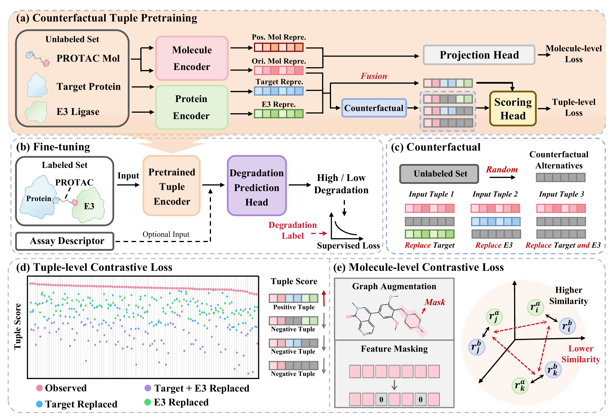

# DegradeQuery

**Counterfactual Tuple Pretraining for Context-Aware PROTAC Degradation Prediction**

Dong Xu, Zhangfan Yang, Jiantao Wu, Zexuan Zhu, Jianqiang Li, and Junkai Ji · **NeurIPS 2026**

[Conference paper](https://neurips.cc/virtual/2026/poster/150093) · [arXiv](https://arxiv.org/abs/2608.10595) · [PROTAC-8K data](https://zenodo.org/records/14728925) · [Reproduction guide](docs/REPRODUCIBILITY.md) · [Citation](#citation)

DegradeQuery predicts high or low degradation for a given proteolysis-targeting chimera (PROTAC), target protein and E3 ubiquitin ligase. It learns from records with missing activity measurements by keeping the molecule fixed and contrasting the recorded tuple with replacements of the target, the ligase, or both. The encoder is then fine-tuned on measured degradation labels.

[](docs/figure-1.pdf)

*Figure 1. Overview of DegradeQuery.* [View the full-size figure (PDF)](docs/figure-1.pdf)

## PROTAC-8K results

On the official benchmark, DegradeQuery achieved **0.9065 AUROC** and **0.8500 accuracy**. The published semi-supervised DegradeMaster baseline achieved 0.8825 AUROC and 0.8366 accuracy on the same benchmark. [Benchmark comparison in the paper](https://arxiv.org/html/2608.10595v1#S4.T1)

A separate five-seed experiment isolates what pretraining adds to the same supervised predictor. The third row restricts pretraining to 7,134 records with missing degradation labels. All three models use the same labeled data for supervised training.

| Training on the official split | Mean AUROC | Mean AUPRC | Mean accuracy |
| --- | ---: | ---: | ---: |
| Supervised baseline | 0.8777 | 0.7925 | 0.7840 |
| Full counterfactual tuple pretraining (CTP) | 0.8996 | 0.8403 | 0.8233 |
| CTP using only unlabeled records during pretraining | 0.9007 | 0.8405 | 0.8267 |

When entire target–E3 pairs were held out from training, mean AUROC across ten splits was **0.7064** with CTP and **0.6769** with supervised training alone. [Download the aggregate results](results/paper_results.csv)

## Run the benchmark

Clone the repository and install the dependencies in a Python 3.11 environment.

```bash
git clone https://github.com/SZU-ADDG/DegradeQuery.git
cd DegradeQuery
python3.11 -m venv .venv
source .venv/bin/activate
python -m pip install -r requirements.txt
```

From the repository root, this command fetches and prepares PROTAC-8K, then trains the supervised and full CTP models for the five-seed comparison above.

```bash
python scripts/reproduce_official.py --prepare-data --seeds 1,2,3,4,5
```

For prepared data, omit `--prepare-data`. Each run writes a checkpoint and metrics under `output/`. Prediction files and the run index in `output/run_manifest.jsonl` let you trace the reported metrics back to individual runs.

<details>
<summary>Manual data preparation and experiment settings</summary>

```bash
python dq.py init
python dq.py fetch --dataset protac8k
python dq.py audit --dataset protac8k --check-leakage
python dq.py prep --dataset protac8k
python dq.py fetchseq --dataset protac8k --source auto
```

The paper runs used Python 3.11.15, PyTorch 2.5.1 and CUDA 12.1. CTP runs use 60 pretraining epochs and 120 supervised fine-tuning epochs. The decision threshold is fixed at 0.5. See the [configuration](config.yaml) and [reproduction guide](docs/REPRODUCIBILITY.md) for the objectives, hyperparameters and evaluation protocol.

For a local installation check, `python dq.py selftest --epochs 2` exercises the supervised pipeline on a synthetic dataset. The [command-line interface](dq.py), [data preparation](dq_data.py) and [model implementation](dq_model.py) are available at the repository root.

</details>

## Reproduce a specific experiment

| Research question | Released splits and instructions |
| --- | --- |
| How much can the model learn from records without degradation labels? | [Unlabeled-only split](splits/official) · [Training commands](docs/REPRODUCIBILITY.md#unlabeled-only-ctp) |
| Does pretraining help on unseen target–E3 combinations? | [Ten group holdouts](splits/target_e3) · [Evaluation protocol](docs/REPRODUCIBILITY.md#target-e3-group-holdout) |
| How well does the model adapt to a held-out target with a few labeled examples? | [Nine original few-shot splits](splits/fewshot) · [2, 4 or 8 examples per class](docs/REPRODUCIBILITY.md#target-wise-few-shot-adaptation) |
| How well do predicted probabilities match observed degradation labels? | [Calibration splits](splits/calibration) · [Calibration procedure](docs/REPRODUCIBILITY.md#train-side-calibration-splits) |

The [reproduction guide](docs/REPRODUCIBILITY.md) also covers molecular scaffold holdouts, ESM2-650M protein representations, component ablations and counterfactual sampling.

## Citation

If you use DegradeQuery in your research, please cite the [NeurIPS paper](https://neurips.cc/virtual/2026/poster/150093).

```bibtex
@inproceedings{xu2026degradequery,
  title     = {{DegradeQuery}: Counterfactual Tuple Pretraining for Context-Aware {PROTAC} Degradation Prediction},
  author    = {Xu, Dong and Yang, Zhangfan and Wu, Jiantao and Zhu, Zexuan and Li, Jianqiang and Ji, Junkai},
  booktitle = {Advances in Neural Information Processing Systems},
  year      = {2026},
  eprint    = {2608.10595},
  archivePrefix = {arXiv},
  url       = {https://neurips.cc/virtual/2026/poster/150093}
}
```

The code is available under the [MIT License](LICENSE). Third-party datasets and pretrained models retain their original terms.
